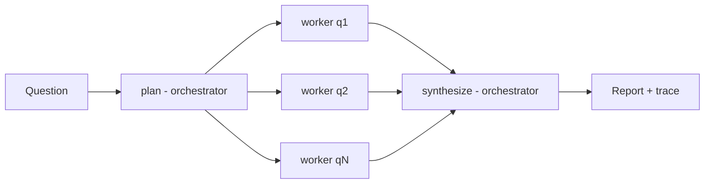

# multi-agent-researcher

Orchestrator + parallel web-search sub-agents that produce cited research reports.

[](https://github.com/Muhaman/multi-agent-researcher/actions/workflows/ci.yml)

## What it does

Give it a question. An orchestrator model (`claude-opus-5-5`) splits it into independent sub-questions, one worker per sub-question (`claude-sonnet-5-5`) researches it with the server-side `web_search_20260209` tool in parallel, and the orchestrator synthesizes a Markdown report with numbered `[n]` citations and a Sources list. A JSON trace records every step's model, duration and token usage.

## Architecture



## Quickstart

```bash
uv sync --dev
export ANTHROPIC_API_KEY=...        # see .env.example for model overrides
uv run research "How do solid-state batteries differ from lithium-ion?" -o report.md --trace trace.json
```

Docker: `docker build -t researcher . && docker run --rm -e ANTHROPIC_API_KEY researcher "Your question"`.

## Usage

```
research QUESTION [-o report.md] [--workers 4] [--searches 3] [--trace trace.json]
```

- `--workers` 1-8: sub-agents run in parallel (the plan is truncated to this many).
- `--searches` 1-10: `max_uses` of web search per worker.
- Without `-o` the report goes to stdout; logs are JSON on stderr.

## Design decisions & trade-offs

- **Failure isolation**: a worker's exception, refusal or search error becomes `Finding(error=...)`; synthesis skips errored findings. Only when every worker fails does `research` raise `ResearchFailed`.
- **Server-tool errors are data**: web search errors arrive as HTTP 200 with an error object in the result block; a worker with an error and no sources is reported as failed rather than crashing.
- **`pause_turn`**: the worker re-sends the accumulated assistant turn (up to 3 times) so the server resumes its search loop.
- **Prompt-injection posture**: synthesis is told that findings are web-derived data, not instructions.
- **Refusal fallbacks** (`fallbacks: "default"`) are sent only for models that support them (`claude-opus-5-5`, `claude-sonnet-5-5`); other models get a typed `LlmRefusalError` instead.
- **Injectable LLM**: all model access sits behind a small `Llm` protocol, so orchestration is tested with deterministic fakes and no network.

## Testing

```bash
uv run pytest -q && uv run mypy src && uv run ruff check . && uv run ruff format --check .
```

Tests use fakes only (concurrency overlap, partial/total worker failure, `pause_turn`, budget bounds, CLI output, error mapping). No live API calls run in CI, so the README makes no quality or cost claims.

## Limitations & next steps

- Sources come from search results and citations; the report's `[n]` mapping is produced by the model and not post-validated.
- No streaming or progress output; long runs are silent until complete.
- No retry/backoff beyond the SDK defaults.
- Workers do not share context or deduplicate overlapping searches.

## License

MIT
